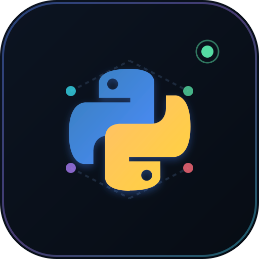

# Python Visual Playground

**See how Python thinks.** Write Python, hit run, and watch it execute step by step — variables, values, the call stack, loops, recursion, output, and errors all come alive as an interactive visual story.

<p align="center">
  
</p>

<p align="center">
  <em>Python 3.11+ · FastAPI · React + TypeScript · runs fully offline</em>
</p>

---

## What it does

- **Step through real execution** — every line, call, return, and exception from an actual Python run.
- **Watch state change** — variables, heap objects, and references update as you move through time.
- **Plain-language explanations** — each step is described in beginner terms, generated from the real before/after state. No network needed.
- **Optional AI tutor** — ask free-form questions about the current line, value, or error. Bring your own key, or run without it.
- **Safe by design** — user code runs in an isolated subprocess with no file, network, or process access and strict resource limits.

---

## Quick start

```bash
python -m venv .venv
source .venv/bin/activate
pip install -r backend/requirements.txt
uvicorn backend.app:app --host 127.0.0.1 --port 8000
```

Open **http://localhost:8000** and press **Run & visualise** (or `Ctrl/Cmd + Enter`).

> Only Python 3.11+ is needed to run the checked-in build. Node.js 20+ is required only if you rebuild the frontend.

---

## 🤖 AI tutor (optional)

The playground works fully offline. To enable the AI tutor, open **Settings → AI tutor** in the UI, pick a provider (OpenAI, Anthropic, OpenRouter, or NVIDIA NIM), and paste a key — it's stored only in your browser.

Prefer the server side? Create a git-ignored `backend/.env`:

```bash
LLM_API_KEY=your-key-here
LLM_BASE_URL=https://integrate.api.nvidia.com/v1   # optional default
LLM_MODEL=minimaxai/minimax-m3.1-flash             # optional default
```

Check `GET /api/health` to confirm whether the tutor is `enabled` or `offline`.

---

## How it works

| Layer | What it does |
| --- | --- |
| **Frontend** | React + TypeScript with a syntax-aware editor and custom SVG/CSS visualisations. The trace is immutable and replayed for time travel. |
| **API** | FastAPI spins up a fresh, isolated Python process for every run. |
| **Tracer** | `sys.settrace` captures real `call` / `line` / `return` / `exception` events; AST analysis adds program structure. |
| **Safety** | Restricted built-ins and imports, no file/network/process APIs, and CPU / memory / output / recursion / time limits. |

> Subprocess isolation is right for local learning and trusted classrooms. For a public multi-tenant service, run each trace in a locked-down container or microVM.

---

## Tests

```bash
pytest backend/tests -q      # backend tracer
cd frontend && npm test      # frontend
```

---

## Rebuild the frontend

```bash
cd frontend
npm install
npm run build
```

FastAPI serves `frontend/dist` automatically when the production build exists.

---

## Supported in v1

Variables, arithmetic, strings, lists, tuples, dicts, sets · `if`/`for`/`while`/`break`/`continue` · functions, recursion, local/global scope · `print` and replayed `input()` · exceptions and `try`/`except` · basic classes and comprehensions · safe standard modules (`math`, `random`, `collections`, `itertools`, `re`, and more).

**Not supported (by design):** filesystem, network, shell, async, threads, and third-party packages.
